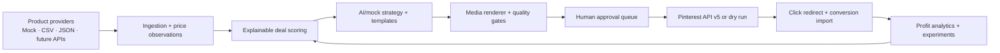

# DealForge

DealForge is a production-shaped, Pinterest-first operating system for an
affiliate deal-discovery business. It ingests products, records observed price
history, scores opportunities by expected profit, creates original social
content, renders Pin/video assets, enforces compliance gates, publishes through
official APIs, and reconciles clicks, conversions, revenue, and costs.

The expanded commercial-intelligence layer adds structured keyword intent and
clusters, relevant-board selection, grounded SEO briefs, keyword-to-profit
attribution, affiliate-program research/scoring, confidence-aware product
opportunities, price/discount-band learning, watchlists, and guarded SEO tests.

The default experience is safe and credential-free:

- `DEMO_MODE=true` seeds realistic products, 90 days of observed prices, deals,
  content, publications, traffic, conversions, costs, and a strategy snapshot.
- `DRY_RUN=true` creates complete publication records without calling Pinterest.
- `AUTO_PUBLISH=false` requires human approval.
- `ENABLE_PAID_ADS=false` makes real ad spend impossible.

## Launch the demo

Requirements: Docker Desktop with Compose v2 and at least 4 GB free memory.

```bash
docker compose up --build
```

No `.env` file is required for the demo. Open:

- Dashboard: <http://localhost:3000>
- API documentation: <http://localhost:8000/docs>
- API health: <http://localhost:8000/api/v1/health>

The first startup builds containers, applies the Alembic migration, seeds the
demo, renders original Pins, and starts the API, web app, worker, scheduler,
PostgreSQL, and Redis.

## Local developer setup

```bash
python3.12 -m venv .venv
.venv/bin/pip install -e '.[dev]'
npm install
cp .env.example .env
```

For a lightweight API-only run, change `DATABASE_URL` in `.env` to
`sqlite:///./dealforge.db`, set `MEDIA_ROOT=media/generated`, then run:

```bash
.venv/bin/alembic upgrade head
.venv/bin/uvicorn apps.api.main:app --reload
npm run dev:web
```

Useful verification commands:

```bash
.venv/bin/pytest
.venv/bin/ruff format --check apps workers tests
.venv/bin/ruff check apps workers tests
.venv/bin/mypy apps workers
npm run lint:web
npm run typecheck:web
npm run test:web
npm run build:web
```

## Architecture at a glance



The API owns business rules. External product, AI, TTS, storage, social,
conversion, alert, and paid-promotion capabilities sit behind adapters. The
Next.js dashboard never exposes the admin token: mutations pass through a
server-side proxy. See [Architecture](/Users/radalzubi/Documents/ChatGPT/Affiliate/docs/ARCHITECTURE.md).

## Switch from demo to production

1. Copy `.env.example` to `.env` and rotate `ADMIN_API_KEY`, database password,
   and `ANONYMIZATION_SALT`.
2. Set `DEMO_MODE=false`; import a compliant product CSV/JSON feed or add an
   approved provider adapter.
3. Configure an affiliate program and confirm its link/disclosure rules.
4. Register a Pinterest business app, complete OAuth, choose a board, and test
   against the Pinterest sandbox/trial tier.
5. Keep `DRY_RUN=true` and `AUTO_PUBLISH=false` through at least 20 manual
   reviews. Verify price accuracy, disclosure visibility, and asset rights.
6. Set `DRY_RUN=false` to allow approved manual publication.
7. Only after an additional review period, optionally set `AUTO_PUBLISH=true`.

See [Setup](/Users/radalzubi/Documents/ChatGPT/Affiliate/docs/SETUP.md),
[Pinterest](/Users/radalzubi/Documents/ChatGPT/Affiliate/docs/PINTEREST.md), and
[Deployment](/Users/radalzubi/Documents/ChatGPT/Affiliate/docs/DEPLOYMENT.md).

## Credentials and accounts still required

- An approved Pinterest business developer app: app ID, app secret, OAuth access,
  board ID, and exact redirect URI.
- At least one affiliate program account, tracking ID, product-feed/API access,
  and its exact disclosure and direct-link rules.
- Optional OpenAI API project key. Without it, deterministic content remains
  fully functional.
- Optional S3-compatible bucket and restricted access key.
- A domain and HTTPS certificate before public tracking redirects or OAuth.

## Publishing and advertising safety

To enable Pinterest publishing, `DRY_RUN=false`, valid Pinterest credentials,
a board ID, fresh in-stock product data, an affiliate link, a visible disclosure,
approved content (unless auto-publish is deliberately enabled), and all automated
quality checks must agree.

Paid promotion is an abstraction plus spend import in this MVP. No advertising
API can spend money. Eligibility still requires `ENABLE_PAID_ADS=true`, positive
daily/monthly/per-content hard budgets, winner status, minimum impressions, CTR,
and conversions. See [Paid promotion](/Users/radalzubi/Documents/ChatGPT/Affiliate/docs/PAID_PROMOTION.md).

## Recommended initial niche and 30-day test

Start with **small-space desk setup deals** in the US. It is visual, problem-led,
evergreen, bundle-friendly, and narrower than generic tech deals.

- Days 1–7: 2 Pins/day, manual approval, 20–30 products, no ads. Test
  `problem_solution` versus `under_50` hooks.
- Days 8–14: 3 Pins/day if rejection rate is below 10% and feeds stay fresh.
  Optimize outbound CTR, not engagement alone.
- Days 15–21: retain price bands and categories producing at least one attributed
  conversion; retire repetitive/low-CTR variants.
- Days 22–30: 3–5 Pins/day. Only consider a small paid test for a true winner with
  500+ organic impressions, CTR above 2.5%, and at least one conversion.

Primary success metric: attributable gross profit. First diagnostic metrics:
outbound CTR, earnings per click, conversion rate, and revenue per 1,000 impressions.

## Estimated early monthly software cost

These are planning estimates as of 2026-08-14, excluding advertising, taxes, and
affiliate/provider fees:

| Component | Lean estimate |
|---|---:|
| Shared 2–4 vCPU VPS for web/API/Postgres/Redis/worker | $10–$30 |
| Object storage for early media volume | $0–$5 |
| OpenAI content generation with batching/caching | $5–$35 |
| Domain, backups, monitoring/email allocation | $5–$20 |
| **Expected total** | **$20–$90/month** |

This remains below the requested $50–$150 target at early volume. Actual AI cost
depends on token volume; every call is recorded and hard budgeted. Cloudflare R2
currently includes a free standard-storage allowance and lists standard storage
at $0.015/GB-month with no direct egress charge, but verify before deployment.

## Known MVP limitations

- The included real retailer is intentionally a mock catalog: live product feeds
  require the affiliate/provider access you choose. CSV and JSON imports work now.
- Pinterest image Pin publication is implemented; video generation is supported,
  while live video upload remains export-ready until validated against the
  approved account’s current media-upload access.
- Instagram, TikTok, and YouTube are official-API-ready interfaces with manual
  export packages, not unofficial login bots.
- OAuth refresh metadata is encrypted at rest; automatic refresh rotation should
  be completed after receiving the exact production app grant behavior.
- The application limiter is process-local. Put a CDN/WAF or API gateway rate
  limiter in front of a horizontally scaled deployment.
- The demo uses abstract original product illustrations because no authorized
  retailer media was supplied.

## Repository map

```text
apps/api/                 FastAPI domain and integration adapters
apps/web/                 Next.js admin dashboard
workers/                  Celery tasks and schedule
templates/                Configurable content templates
infrastructure/alembic/   Production migrations
media/generated/          Development media output (ignored)
scripts/                  Backup and restore operations
tests/                    Safety and commercial-logic tests
docs/                     Beginner-friendly operating documentation
```

Commercial intelligence guides:

- [Pinterest SEO](docs/PINTEREST_SEO.md)
- [Affiliate discovery](docs/AFFILIATE_DISCOVERY.md)
- [Product discovery](docs/PRODUCT_DISCOVERY.md)
- [Opportunity scoring](docs/OPPORTUNITY_SCORING.md)
- [SEO experimentation](docs/SEO_EXPERIMENTATION.md)
- [Consolidated SEO and affiliate-profit operating guide](docs/SEO_AFFILIATE_MASTER_GUIDE.md)

The repository never contains credentials. Run secret scanning before every
release and keep `.env` out of Git.
